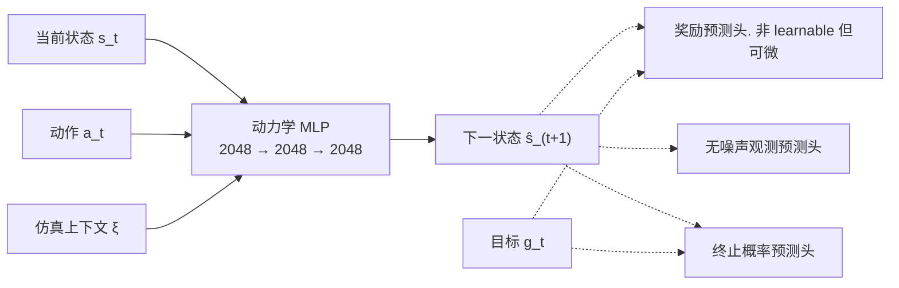
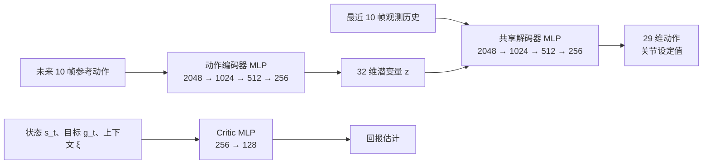

时间预算非常不够，大概读一下，只看 idea.

## Dream1 (91)

https://dreamlabs.ai/research/dream-1/

没有提到架构，只说 eef, 并且认为 WAM 有自动适应本体和头部视角的能力.

其实 demo 拍摄的比较拉，但是我们真机 zero-shot 实测其实还可以.

## BOE (92)

⭐️⭐️ 方佳鑫, FDU, 椰青分享 | https://www.alphaxiv.org/abs/2610.14746

用 learnable query （直接放 video dit） 代替 MoT. ae 只有两层.

主要是为了加速，以及（据称）减少无关视觉干扰.

## ForceWAM (93)

⭐️⭐️⭐️ zijun xu, wendi chen, FDU, SJTU, 杨理欣

训练一个预测未来六轴力矩的 WM，然后小型 IDM, reactive.

训练数据有 demo & play，其中 play 是探索性按压等非成功操作. Play 数据只用于训练 IDM.

## EvoMemVLA (94)

⭐️⭐️ yuheng na, haoang li, XJTU | https://www.alphaxiv.org/pdf/2610.05418

为了增强记忆能力，用 DINOV3 提取图片特征后，训练 LAPA-style 相邻帧隐式动力学 encoder，插入 state 历史中送入 VLM.

## SuperMimic (95)

⭐️⭐️⭐️⭐️⭐️ qiayuan liao, UCB | https://www.alphaxiv.org/abs/2610.28480

引入 WM 加速 rollout 10 倍，通过 32 步 wm imagine 将 policy 训练时样本效率提升 64 倍.

不是这 idea 也许做运控的其他人也能想到... 但是到底咋调出来的...

## FOMI (96)

yishu shen, yinghao xu, HKUST 港科大 | 剪刀手 UMI. 没有安装力传感器也没有安装触觉传感器。Why not use generalist?

## When One Step Is Enough (97)

⭐️⭐️⭐️ 日本 ARAYA Inc | https://www.alphaxiv.org/abs/2610.30735

拿 SmolVLA、X-VLA、FLOWER、π0.5、LAP 以及 XR-0 这六个模型的官方 ckpt 测试 FM 多步积分和单步积分.

结论是对于 1B 以上并且训练充分的模型，一步和多步基本等价

然而 qwen-manip 中呈现 FM4 和 FM10 在 robotwin c2r (joint) 上有显著差异.

## EmbodiedEvo (98)

Einsai.AI(香港, Calvin Xiao) | https://www.alphaxiv.org/abs/2610.18867

智能体先在每类任务的单一演练场景（Playground）中探索，将沉淀的 skills & lessons 固化后直接迁移给新场景中的独立智能体复用. 在依赖记忆的任务和协调动作更有优势.

## FLORA (99)

NVIDIA 推出的切分、标注和打分模型，是三个 Qwen 训练的.

